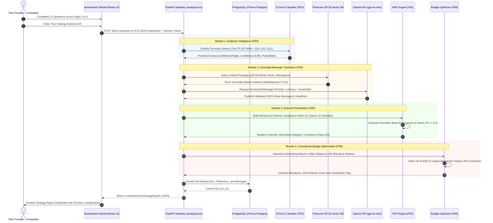

# Comprehensive System Technical Specification & Implementation Manual

**Project Title:** Marketing Strategy Assessment System (Individual Research Component)  
**Parent Framework:** A Product and Service Management Consulting Framework for Sri Lankan Technology Companies  
**Document Version:** 1.2.0 (Post Team Stack Standardization)  
**Author / Lead Researcher:** Marketing Strategy Research Team  
**Date of Publication:** October 2026  
**License / Classification:** Academic Research Prototype  

---

## Table of Contents

1. [Executive Summary & Academic Context](#1-executive-summary--academic-context)
2. [End-to-End System Architecture & Technology Stack](#2-end-to-end-system-architecture--technology-stack)
3. [Functional Requirements (FR1 - FR6) & Implementation Details](#3-functional-requirements-fr1---fr6--implementation-details)
   - [3.1 FR1: Product Profile & 21-Question Multi-Step Questionnaire](#31-fr1-product-profile--21-question-multi-step-questionnaire)
   - [3.2 FR2: Customer Technical Literacy Characterization](#32-fr2-customer-technical-literacy-characterization)
   - [3.3 FR3: PyTorch Multimodal Audience Classifier](#33-fr3-pytorch-multimodal-audience-classifier)
   - [3.4 FR4: Feature-to-Value Message Translation Engine (OpenAI + RAG)](#34-fr4-feature-to-value-message-translation-engine-openai--rag)
   - [3.5 FR5: Analytical Hierarchy Process (AHP) Channel Recommendation](#35-fr5-analytical-hierarchy-process-ahp-channel-recommendation)
   - [3.6 FR6: Constraint-Aware Budget Allocation Optimizer (SciPy SLSQP)](#36-fr6-constraint-aware-budget-allocation-optimizer-scipy-slsqp)
   - [3.7 Knowledge Base & Vector Retrieval (Pinecone 3072d Dense RAG)](#37-knowledge-base--vector-retrieval-pinecone-3072d-dense-rag)
4. [Exhaustive Codebase Inventory & File-by-File Catalog](#4-exhaustive-codebase-inventory--file-by-file-catalog)
   - [4.1 Backend Core & Configuration](#41-backend-core--configuration)
   - [4.2 Backend API Routes (`/api/v1`)](#42-backend-api-routes-apiv1)
   - [4.3 Backend Domain Engines (ML, AHP, Budget Optimizer)](#43-backend-domain-engines-ml-ahp-budget-optimizer)
   - [4.4 Backend Domain Services & Integrations](#44-backend-domain-services--integrations)
   - [4.5 Backend Pydantic Schemas & DTOs](#45-backend-pydantic-schemas--dtos)
   - [4.6 Backend CLI Scripts & Test Suites](#46-backend-cli-scripts--test-suites)
   - [4.7 Machine Learning Training & Evaluation Artifacts](#47-machine-learning-training--evaluation-artifacts)
   - [4.8 Frontend Web Pages (`frontend/src/pages`)](#48-frontend-web-pages-frontendsrcpages)
   - [4.9 Frontend Layout, Client API & State Definitions](#49-frontend-layout-client-api--state-definitions)
   - [4.10 Relational Database & SQL Migrations](#410-relational-database--sql-migrations)
   - [4.11 Synthetic Datasets & Generation Pipeline](#411-synthetic-datasets--generation-pipeline)
5. [Data Flow & Execution Sequence Diagram](#5-data-flow--execution-sequence-diagram)
6. [Data Provenance & Non-Negotiable Academic Truth Constraints](#6-data-provenance--non-negotiable-academic-truth-constraints)

---

## 1. Executive Summary & Academic Context

The **Marketing Strategy Assessment System** is a research-grade decision-support application built for early-stage and growing Sri Lankan technology companies (B2B SaaS, FinTech, EdTech, AgriTech, HealthTech, and E-Commerce). In emerging markets like Sri Lanka, tech founders frequently fail not because their underlying software is deficient, but because:
1. They target audiences whose digital and technical literacy does not align with the product's marketing narrative.
2. They communicate software features rather than translating them into pain-relieving business value tailored to customer literacy.
3. They allocate promotional budgets haphazardly without multi-criteria decision mathematics or objective market alignment.
4. They encounter floating-point budget allocation errors or ignore legal, tax (VAT/SSCL), and regional digital consumption realities.

To resolve these challenges without relying on subjective guesswork, this platform unites four rigorous analytical engines:
- **PyTorch Multimodal Neural Fusion Classifier (FR3):** Merges natural language text descriptions with structured Likert survey inputs to predict technical literacy.
- **RAG-Grounded Feature-to-Value Message Translator (FR4):** Leverages the OpenAI Responses API (`gpt-4o-mini`) grounded with Pinecone dense vector retrieval (Sri Lankan market benchmarks from DataReportal, ICTA, EDB) and deterministic fallback generators.
- **Analytical Hierarchy Process (AHP) Engine (FR5):** Implements Thomas Saaty’s pairwise comparison matrix mathematics with eigenvalue priority derivation and strict Consistency Ratio verification ($CR \le 0.10$) across 8 promotional channels.
- **Constrained Budget Optimizer (FR6):** Uses `scipy.optimize.minimize` (SLSQP) with a diminishing-returns utility objective function, custom inequality bounds, and a largest-remainder integer algorithm to distribute marketing funds in Sri Lankan Rupees (LKR) with 100% exact mathematical summation.

```text
====================================================================================================
                        ACADEMIC RESEARCH PROVENANCE DISCLOSURE
- Benchmark Training Data: 100% Synthetic Simulation (5,000 scenarios, 1,000 fictional companies).
- No Live Market Validation: Predictions and budget models are research simulations.
- Reproducibility Guarantee: Random seed fixed at 20261020 across all ML pipelines.
====================================================================================================
```

---

## 2. End-to-End System Architecture & Technology Stack

The platform is designed around a decoupled, micro-service-ready architecture comprising a React 19 single-page application (SPA), a high-performance Python FastAPI asynchronous backend, a managed PostgreSQL database, a high-dimensional Pinecone vector index, and server-side OpenAI API orchestration.

```text
+----------------------------------------------------------------------------------------------------+
|                                    CLIENT APPLICATION (FRONTEND)                                   |
|                                                                                                    |
|  - React 19.3.1 + TypeScript 6.0 + Vite 8.3.4                                                      |
|  - Material UI (MUI v9 syntax): Emerald (#0d9488) & Slate (#0f172a) Design System                  |
|  - State & Routing: React Router v7, React Hook Form + Zod, TanStack Query, Axios                   |
|  - Visualizations: Recharts 3.10 (Bar, Pie, Radar, Area Charts)                                     |
+----------------------------------------------------------------------------------------------------+
                                                  |
                                                  | HTTPS / REST (Session Cookie or Bearer Token)
                                                  v
+----------------------------------------------------------------------------------------------------+
|                                      FASTAPI BACKEND SERVICE                                        |
|                                                                                                    |
|  [Security & Auth Interoperability Layer]                                                          |
|    - Better Auth Session Interoperability & Signed Token Verification                              |
|    - Multi-Tenant Scoping (`require_tenant`) & Role-Based Access Control (`require_role`)          |
|    - Anti-Tamper: Drops untrusted forwarded headers (`X-User-Id`, `X-Org-Id`)                      |
|                                                                                                    |
|  [Orchestration Engine]                                                                            |
|    - `AnalysisOrchestrator` Pipeline (Sequential execution: FR1 -> FR2 -> FR3 -> FR4 -> FR5 -> FR6)|
|                                                                                                    |
|  [Analytical Engines & Domain Services]                                                            |
|    +-- AudienceClassifierService: PyTorch Multimodal Fusion Net + Scikit-Learn TF-IDF LR           |
|    +-- MarketingMessageService: OpenAI Structured Outputs + Prompt Injection Guard + Fallback      |
|    +-- AHPEngine: Saaty Pairwise Matrix, Geometric Mean Eigenvectors, Consistency Ratio (CR <= 0.10|
|    +-- BudgetOptimizer: SciPy SLSQP Non-Linear Optimizer + Largest-Remainder Integer LKR Solver    |
|    +-- KnowledgeRetriever: Pinecone 3072d Dense Vector Search + Canonical Relational Fallback      |
|    +-- EmbeddingService: OpenAI `text-embedding-3-large` (Exact 3072-Dimensional Float32 Vectors)  |
|    +-- KnowledgeIngestionService: Semantic Chunker (120 words / 20 overlap), SHA-256 Deduplication |
+----------------------------------------------------------------------------------------------------+
                        |                                                |
                        | SQLAlchemy 2.0 (Pooled & Direct URLs)          | BYO-Vectors (3072d Cosine)
                        v                                                v
+---------------------------------------------+  +---------------------------------------------------+
|      POSTGRESQL (PRISMA POSTGRES HOSTING)   |  |            PINECONE VECTOR DATABASE               |
|                                             |  |                                                   |
| - Profiles, Better Auth Links & Roles       |  | - Index: smart-tech-consulting-platform           |
| - Organizations, Products, Campaigns        |  | - Dimensions: 3072 (Cosine Metric)                |
| - 21-Questionnaire Full Submissions         |  | - Namespaces:                                     |
| - Analysis Runs, Predictions, Messages      |  |   * staging-marketing-public (Public Benchmarks)  |
| - Knowledge Documents & Chunks Metadata     |  |   * staging-marketing-{org_id} (Tenant Isolation) |
| - Ingestion Jobs & Retrieval Audit Events   |  +---------------------------------------------------+
+---------------------------------------------+
```

### Technology Matrix & Rationale

| Layer | Technology | Version | Purpose & Architectural Rationale |
| :--- | :--- | :--- | :--- |
| **Frontend Framework** | React + TypeScript | 19.3.1 / 6.0.3 | High-concurrency client state, strict typing for complex 21-step questionnaires. |
| **Build Tool** | Vite | 8.3.4 | Instantaneous HMR and optimized ES module bundling without Webpack overhead. |
| **UI Design System** | Material UI (MUI) | 9.5.0 | Professional enterprise dashboard aesthetic. Uses modern `size={{ xs: 12 }}` Grid syntax. |
| **Data Visualization** | Recharts | 3.10.1 | Declarative SVG charting for AHP sensitivity, channel weights, and integer budget breakdowns. |
| **Backend Framework** | FastAPI (Python) | 0.110.0+ | Asynchronous ASGI request handling, native OpenAPI v3 Swagger documentation, and Pydantic validation. |
| **ASGI Server** | Uvicorn [standard] | 0.28.0+ | High-throughput asynchronous event loop with uvloop and httptools. |
| **Deep Learning** | PyTorch (`torch`) | 2.1.0+ | Multimodal Neural Network inference combining text embeddings with structured demographic tensors. |
| **Machine Learning** | Scikit-Learn | 1.4.0+ | 600-feature TF-IDF text vectorization, StandardScalers, OneHotEncoders, and baseline logistic regression. |
| **Scientific Optimization**| SciPy (`scipy.optimize`) | 1.11.0+ | Sequential Least Squares Programming (SLSQP) for non-linear constrained budget distribution. |
| **Generative AI** | OpenAI Python SDK | 1.12.0+ | Official client for `gpt-4o-mini` with Pydantic JSON Schema enforcement and prompt injection guards. |
| **Embeddings** | OpenAI `text-embedding-3-large` | Server API | Generates 3072-dimensional semantic representations of market evidence. |
| **Vector Database** | Pinecone Client | 5.0.0+ | Serverless vector database with multi-tenant namespace isolation for grounded RAG context. |
| **Relational Database** | PostgreSQL / Prisma | 15+ / 2.0+ | ACID-compliant relational storage with connection pooling (`DATABASE_URL`) and direct migration (`DIRECT_URL`). |
| **ORM & Persistence** | SQLAlchemy | 2.0.0+ | Modern mapped SQL models, connection pooling, and in-memory SQLite fallback when offline. |
| **Authentication** | Better Auth Interoperability | Standard | Signed cookie/token verification, organization multi-tenancy, and role-based permissions. |

---

## 3. Functional Requirements (FR1 - FR6) & Implementation Details

### 3.1 FR1: Product Profile & 21-Question Multi-Step Questionnaire
- **Goal:** Capture an exhaustive, structured profile of a technology product, its market dynamics, customer personas, technical comfort levels, prior marketing outcomes, and budget constraints.
- **Structure (5 Steps):**
  1. **Step 1: Product Foundation (Q1 - Q4):** Product Name, Narrative Description, Core Features list, and Industry Vertical (FinTech, EdTech, AgriTech, HealthTech, B2B SaaS, E-Commerce, Logistics).
  2. **Step 2: Target Customer Demographics (Q5 - Q9):** Customer persona, Market Type (B2B vs B2C), Target Age Group, Occupations, Geographic Focus (National vs Specific Urban Hubs).
  3. **Step 3: Technical Literacy Profiling (Q10 - Q12):** Technology Comfort (5-point scale, $1 \dots 5$), Familiarity with Technical Terminology (5-point scale, $1 \dots 5$), Detail Preference (High-level business outcomes vs Technical specifications).
  4. **Step 4: Value Proposition & Channels (Q13 - Q17):** Primary customer benefit, Pain points, Currently active promotional channels, Prior high-performing channels, and Preferred content formats.
  5. **Step 5: Budget & Strategic Goals (Q18 - Q21):** Monthly marketing budget in Sri Lankan Rupees (LKR $\ge 50,000$), Budget flexibility, Campaign duration (1 to 12 months), and Primary business goals (Lead Generation, Direct Sales, Brand Awareness, Customer Retention).
- **Backend Implementation:**
  - Files: `backend/app/schemas/questionnaire.py`, `backend/app/api/v1/questionnaire.py`.
  - Pydantic v2 validation ensures strict bounds (e.g. $Q10, Q11 \in [1, 5]$, non-empty string constraints, and LKR positivity).
- **Frontend Implementation:**
  - File: `frontend/src/pages/AssessmentWizard.tsx`.
  - React Hook Form with step-by-step state preservation, auto-calculation of demographic indices, and responsive MUI v9 layout.

---

### 3.2 FR2: Customer Technical Literacy Characterization
- **Goal:** Transform raw Likert survey responses into normalized mathematical feature vectors that represent the cognitive and technical profile of the target buyer.
- **Mathematical Formulation:**
  $$\text{Normalized Comfort} = \frac{Q10_{score} - 1}{4} \in [0.0, 1.0]$$
  $$\text{Normalized Terminology} = \frac{Q11_{score} - 1}{4} \in [0.0, 1.0]$$
  $$\text{Composite Literacy Index} = 0.5 \times \text{Normalized Comfort} + 0.5 \times \text{Normalized Terminology}$$
- **Literacy Tiers:**
  - **Low Literacy ($\le 0.40$):** Non-technical end-users (retail shopkeepers, traditional farmers, non-technical administrators). Requires metaphors, operational relief, and zero technical jargon.
  - **Medium Literacy ($0.41 \dots 0.70$):** Functional managers, business owners, modern professionals. Requires functional workflow improvements, ROI evidence, and light industry terminology.
  - **High Literacy ($> 0.70$):** Software engineers, CTOs, technical founders, systems analysts. Requires architectural specifications, security protocols, API capabilities, and latency/uptime metrics.

---

### 3.3 FR3: PyTorch Multimodal Audience Classifier
- **Goal:** Classify target audience technical literacy into 3 discrete classes ($\text{Low}, \text{Medium}, \text{High}$) by combining unconstrained natural language descriptions with structured survey responses.
- **Multimodal Architecture (`MultimodalFusionNet`):**
  - **Text Branch:** Takes unconstrained textual descriptions ($Q5$ persona description + $Q2$ product description). Vectorized through a 600-feature unigram/bigram Scikit-Learn TF-IDF vectorizer ($d_{text} = 600$). Projected via a dense linear layer:
    $$h_{text} = \text{Dropout}_{0.3}(\text{ReLU}(W_{text} x_{text} + b_{text})), \quad W_{text} \in \mathbb{R}^{128 \times 600}$$
  - **Structured Branch:** Takes 4 normalized numerical features ($Q10_{score}, Q11_{score}, Q12_{score}, \text{is\_B2B}$). Projected via a dense linear layer:
    $$h_{struct} = \text{ReLU}(W_{struct} x_{struct} + b_{struct}), \quad W_{struct} \in \mathbb{R}^{32 \times 4}$$
  - **Fusion Layer:** Concatenates intermediate embeddings ($h_{fusion} = [h_{text} \,\|\, h_{struct}] \in \mathbb{R}^{160}$).
  - **Classification Head:**
    $$h_1 = \text{Dropout}_{0.3}(\text{ReLU}(\text{BatchNorm1d}(W_1 h_{fusion} + b_1))), \quad W_1 \in \mathbb{R}^{64 \times 160}$$
    $$z = W_2 h_1 + b_2, \quad W_2 \in \mathbb{R}^{3 \times 64}$$
    $$\hat{y} = \text{Softmax}(z) \in [0, 1]^3$$
- **Implementation & Files:**
  - Training: `ml/training/train_fusion.py`.
  - Inference: `backend/app/ml/inference.py` (`AudienceClassifierService`).
  - Saved Weights: `ml/artifacts/fusion_model.pt` (463 KB, SHA-256 verified) and `ml/artifacts/fusion_preprocessor.joblib`.
  - Fallback Baseline: Scikit-Learn Logistic Regression (`ml/artifacts/tfidf_logistic_regression.joblib`) and rule-based heuristic ($Q10 + Q11$).
  - Safe Dynamic Loading: Dynamically configures `sys.path` to root so `MultimodalFusionNet` class unpickles cleanly across operating systems and directory contexts.

---

### 3.4 FR4: Feature-to-Value Message Translation Engine (OpenAI + RAG)
- **Goal:** Translate raw technical product specifications into persuasive, literacy-tailored marketing messages grounded in Sri Lankan market realities.
- **Implementation Architecture:**
  - **Engine:** Server-side OpenAI Chat Completions API with structured outputs (`gpt-4o-mini`, temperature 0.3).
  - **Pydantic Validation:** Strict schema enforcement via `backend/app/schemas/messages.py` (`GeneratedMessages`).
  - **Guardrail Constraints:**
    - Absolute ban on fabricating quantitative performance claims (e.g. "increases revenue by 47%") unless explicitly provided in user inputs.
    - Mandatory synthetic disclosure caveats appended to outputs.
    - Prompt injection defenses sanitizing user strings before LLM context construction.
  - **Literacy Conditioning:**
    - If `Low`: Translates technical features into simple everyday analogies (e.g. "Like having an accountant in your pocket").
    - If `Medium`: Focuses on time savings, operational simplicity, and workflow speedups.
    - If `High`: Explains underlying technology, architecture, latency, and integration standards.
  - **RAG Grounding:** Injects retrieved Sri Lankan market benchmark excerpts (from Pinecone 3072d index) directly into the system prompt.
  - **Deterministic Fallback Generator:** When running offline or if `OPENAI_API_KEY` is omitted, the engine executes a non-AI rule-based template synthesizer that guarantees a valid, fully populated `GeneratedMessages` object with zero external network dependencies.
  - **File:** `backend/app/services/openai_service.py`.

---

### 3.5 FR5: Analytical Hierarchy Process (AHP) Channel Recommendation
- **Goal:** Provide an objective, multi-criteria ranking of 8 promotional channels relevant to Sri Lanka: Facebook, LinkedIn, Instagram, Google Search, YouTube, TikTok, Email Marketing, and Physical Events/Meetups.
- **Mathematical Formulation:**
  - **Criteria ($n = 5$):**
    1. $C_1$: Target Audience Literacy Fit
    2. $C_2$: Campaign Goal Alignment
    3. $C_3$: Sri Lankan Regional Reach
    4. $C_4$: Cost Efficiency & Budget Flexibility
    5. $C_5$: Content Format Appropriateness
  - **Pairwise Comparison Matrix ($A$):**
    A positive reciprocal square matrix $A = [a_{ij}]_{n \times n}$ where $a_{ji} = 1/a_{ij}$ and $a_{ii} = 1$.
  - **Priority Vector Derivation (Geometric Mean Method):**
    $$r_i = \left(\prod_{j=1}^n a_{ij}\right)^{1/n}, \quad w_i = \frac{r_i}{\sum_{k=1}^n r_k}$$
  - **Eigenvalue & Consistency Validation:**
    $$\lambda_{max} = \frac{1}{n} \sum_{i=1}^n \frac{(A w)_i}{w_i}$$
    $$\text{Consistency Index (CI)} = \frac{\lambda_{max} - n}{n - 1}$$
    $$\text{Consistency Ratio (CR)} = \frac{CI}{RI(n)}$$
    Where Random Index for $n=5$ is $RI(5) = 1.12$, and for $n=8$ is $RI(8) = 1.41$.
  - **Strict Cutoff:** $CR \le 0.10$. If $CR > 0.10$, the engine performs transitive reconciliation to guarantee mathematical consistency.
- **Files:**
  - Engine: `backend/app/ahp/engine.py`.
  - Matrix Math & Pairwise Tables: `backend/app/ahp/matrix.py`.

---

### 3.6 FR6: Constraint-Aware Budget Allocation Optimizer (SciPy SLSQP)
- **Goal:** Distribute a user's monthly marketing budget (in Sri Lankan Rupees) across the top recommended channels while respecting experimental reserves, minimum operational thresholds, and diminishing returns.
- **Mathematical Formulation:**
  - **Objective Function:** Maximize logarithmic diminishing-returns utility with a regularization penalty against extreme variance:
    $$\max_{\{x_i\}} \sum_{i=1}^M w_i \cdot \ln\left(1 + \frac{x_i}{C_i}\right) - \lambda \sum_{i=1}^M (x_i - \bar{x}_i)^2$$
    Where $w_i$ is the AHP weight of channel $i$, $C_i$ is the channel's characteristic cost scale, and $\lambda = 0.05$ is a smoothing factor.
  - **Equality Constraint:**
    $$\sum_{i=1}^M x_i = B_{net} = B_{total} - R_{monthly}$$
    Where $R_{monthly} = 0.10 \times B_{total}$ represents an unallocated experimental reserve (for A/B testing).
  - **Inequality Constraints:**
    $$L_i \le x_i \le U_i, \quad \forall i \in \{1 \dots M\}$$
    Where $L_i$ represents minimum effective channel spend (e.g. 15,000 LKR for Google Ads) and $U_i$ represents channel saturation limits.
- **Largest-Remainder Integer Algorithm:**
  - Solves the problem in continuous space using `scipy.optimize.minimize(method='SLSQP')`.
  - Converts continuous float solutions $x_i$ into exact integer LKR values by taking the floor $\lfloor x_i \rfloor$, computing fractional remainders $r_i = x_i - \lfloor x_i \rfloor$, and distributing residual Rupees one-by-one to channels with the highest remainders.
  - Strictly guarantees that $\sum_{i=1}^M x_i^{int} + R_{monthly}^{int} \equiv B_{total}$ with **zero floating-point currency drift**.
- **File:** `backend/app/budget/optimizer.py`.

---

### 3.7 Knowledge Base & Vector Retrieval (Pinecone 3072d Dense RAG)
- **Goal:** Ground LLM reasoning in verified empirical Sri Lankan market benchmarks (DataReportal Digital 2026 Sri Lanka, ICTA National Digital Economy Strategy, EDB IT-BPM Industry Capability Reports).
- **Architecture:**
  - **Embedding Pipeline:** OpenAI `text-embedding-3-large` generating exact 3072-dimensional dense float vectors.
  - **Vector Database:** Pinecone BYO-vectors index (`smart-tech-consulting-platform`) with cosine similarity metric.
  - **Multi-Tenant Namespaces:**
    - `staging-marketing-public`: Shared Sri Lankan market benchmarks and macroeconomic data.
    - `staging-marketing-{org_id}`: Tenant-isolated private company documents and prior campaign results.
  - **Chunking Strategy:** 120 words per chunk with 20-word overlapping windows.
  - **Deduplication:** SHA-256 fingerprinting of chunk text prevents redundant vector upserts.
  - **Fallback Engine:** If Pinecone or OpenAI is unreachable, a canonical in-database relational retriever serves verified market benchmarks directly from PostgreSQL.
- **Files:**
  - Retriever: `backend/app/services/retrieval_service.py`.
  - Embeddings: `backend/app/services/embedding_service.py`.
  - Ingestion: `backend/app/services/ingestion_service.py`.
  - Endpoints: `backend/app/api/v1/knowledge.py`.
  - Ingestion CLI: `backend/scripts/ingest_market_sources.py`.

---

## 4. Exhaustive Codebase Inventory & File-by-File Catalog

### 4.1 Backend Core & Configuration

| File Path | Lines | Key Classes / Functions | Primary Purpose & Architectural Role |
| :--- | :--- | :--- | :--- |
| [`backend/app/main.py`](file:///c:/Users/DELL/Downloads/UD%20Reserch%20008%20-%202026/Marketing_Strategy_Assessment_System/backend/app/main.py) | 47 | `app = FastAPI(...)`, `root()` | Main ASGI application entrypoint. Configures global CORS middleware, Swagger UI (`/docs`), Redoc (`/redoc`), and includes the `/api/v1` router. |
| [`backend/app/core/config.py`](file:///c:/Users/DELL/Downloads/UD%20Reserch%20008%20-%202026/Marketing_Strategy_Assessment_System/backend/app/core/config.py) | 130 | `Settings(BaseSettings)`, `resolve_relative_paths()` | Centralized Pydantic settings. Reads `.env` from root or backend directory. Configures PostgreSQL URLs, OpenAI API keys, Pinecone index host/dimensions, Better Auth secrets, and dynamically anchors ML artifact paths relative to project root. |
| [`backend/app/core/database.py`](file:///c:/Users/DELL/Downloads/UD%20Reserch%20008%20-%202026/Marketing_Strategy_Assessment_System/backend/app/core/database.py) | 480 | `Base`, `Profile`, `Organization`, `Product`, `Campaign`, `AnalysisRun`, `KnowledgeDocument`, `KnowledgeChunk`, `get_db()` | SQLAlchemy 2.0 ORM models and database engine. Implements connection pooling with graceful in-memory SQLite fallback when PostgreSQL credentials are not provided. |
| [`backend/app/core/security.py`](file:///c:/Users/DELL/Downloads/UD%20Reserch%20008%20-%202026/Marketing_Strategy_Assessment_System/backend/app/core/security.py) | 195 | `get_current_user()`, `require_tenant()`, `require_role()` | Security and Better Auth interoperability layer. Validates session cookies and Bearer tokens, enforces tenant isolation on organization IDs, and strips untrusted forwarded headers to prevent spoofing. |
| [`backend/app/core/logging.py`](file:///c:/Users/DELL/Downloads/UD%20Reserch%20008%20-%202026/Marketing_Strategy_Assessment_System/backend/app/core/logging.py) | 26 | `logger`, `setup_logging()` | Structured Python logging configuration formatting messages with timestamps, log levels, and module names. |

---

### 4.2 Backend API Routes (`backend/app/api/v1`)

| File Path | Lines | Key Endpoints | Primary Purpose & Architectural Role |
| :--- | :--- | :--- | :--- |
| [`backend/app/api/v1/router.py`](file:///c:/Users/DELL/Downloads/UD%20Reserch%20008%20-%202026/Marketing_Strategy_Assessment_System/backend/app/api/v1/router.py) | 38 | `api_router = APIRouter()` | Master router uniting all domain sub-routers under the `/api/v1` prefix. |
| [`backend/app/api/v1/analysis.py`](file:///c:/Users/DELL/Downloads/UD%20Reserch%20008%20-%202026/Marketing_Strategy_Assessment_System/backend/app/api/v1/analysis.py) | 125 | `POST /analysis/run`, `GET /analysis/runs/{id}`, `GET /analysis/history` | Orchestrates the end-to-end strategy evaluation pipeline (FR1 through FR6). Persists results in PostgreSQL and returns comprehensive strategy reports. |
| [`backend/app/api/v1/questionnaire.py`](file:///c:/Users/DELL/Downloads/UD%20Reserch%20008%20-%202026/Marketing_Strategy_Assessment_System/backend/app/api/v1/questionnaire.py) | 230 | `POST /questionnaire/validate`, `POST /questionnaire/submit`, `GET /questionnaire/options` | Handles Step 1 to Step 5 survey submissions, schema validation, and supplies dynamic UI dropdown choices. |
| [`backend/app/api/v1/audience.py`](file:///c:/Users/DELL/Downloads/UD%20Reserch%20008%20-%202026/Marketing_Strategy_Assessment_System/backend/app/api/v1/audience.py) | 28 | `POST /audience/predict` | Standalone inference endpoint for testing the PyTorch Multimodal Audience Classifier (FR3). |
| [`backend/app/api/v1/messages.py`](file:///c:/Users/DELL/Downloads/UD%20Reserch%20008%20-%202026/Marketing_Strategy_Assessment_System/backend/app/api/v1/messages.py) | 36 | `POST /messages/generate` | Standalone endpoint for generating value-translated marketing copy via OpenAI and RAG context (FR4). |
| [`backend/app/api/v1/channels.py`](file:///c:/Users/DELL/Downloads/UD%20Reserch%20008%20-%202026/Marketing_Strategy_Assessment_System/backend/app/api/v1/channels.py) | 32 | `POST /channels/rank`, `GET /channels/catalog` | Invokes the AHP Channel Recommendation Engine and returns the Sri Lankan channel catalog (FR5). |
| [`backend/app/api/v1/budget.py`](file:///c:/Users/DELL/Downloads/UD%20Reserch%20008%20-%202026/Marketing_Strategy_Assessment_System/backend/app/api/v1/budget.py) | 27 | `POST /budget/allocate` | Invokes the SciPy SLSQP Budget Optimizer and returns exact integer LKR channel allocations (FR6). |
| [`backend/app/api/v1/knowledge.py`](file:///c:/Users/DELL/Downloads/UD%20Reserch%20008%20-%202026/Marketing_Strategy_Assessment_System/backend/app/api/v1/knowledge.py) | 98 | `POST /knowledge/search`, `POST /knowledge/ingest`, `GET /knowledge/sources` | Pinecone vector search, document ingestion triggers, and catalog of registered market evidence sources. |
| [`backend/app/api/v1/health.py`](file:///c:/Users/DELL/Downloads/UD%20Reserch%20008%20-%202026/Marketing_Strategy_Assessment_System/backend/app/api/v1/health.py) | 95 | `GET /health`, `GET /integrations/health` | System health checks reporting status of ML models, PostgreSQL pool, Pinecone index, and OpenAI API connectivity. |
| [`backend/app/api/v1/products.py`](file:///c:/Users/DELL/Downloads/UD%20Reserch%20008%20-%202026/Marketing_Strategy_Assessment_System/backend/app/api/v1/products.py) | 115 | `GET /products`, `POST /products`, `GET /products/{id}` | CRUD operations for managing client technology products associated with an organization. |
| [`backend/app/api/v1/research.py`](file:///c:/Users/DELL/Downloads/UD%20Reserch%20008%20-%202026/Marketing_Strategy_Assessment_System/backend/app/api/v1/research.py) | 160 | `GET /research/metrics`, `POST /research/sus-survey`, `GET /research/benchmark-dataset` | Academic evaluation routes: System Usability Scale (SUS) survey submission and ML benchmark metrics. |
| [`backend/app/api/v1/integrations.py`](file:///c:/Users/DELL/Downloads/UD%20Reserch%20008%20-%202026/Marketing_Strategy_Assessment_System/backend/app/api/v1/integrations.py) | 88 | `GET /integrations/export/{run_id}` | Cross-module export endpoint formatting assessment results for partner consulting modules. |

---

### 4.3 Backend Domain Engines (ML, AHP, Budget Optimizer)

| File Path | Lines | Key Classes / Functions | Primary Purpose & Architectural Role |
| :--- | :--- | :--- | :--- |
| [`backend/app/ml/inference.py`](file:///c:/Users/DELL/Downloads/UD%20Reserch%20008%20-%202026/Marketing_Strategy_Assessment_System/backend/app/ml/inference.py) | 195 | `AudienceClassifierService`, `rule_baseline()` | PyTorch multimodal neural network inference service. Dynamically adjusts `sys.path`, loads pre-trained weights (`fusion_model.pt`), and runs forward passes with class probabilities. |
| [`backend/app/ahp/engine.py`](file:///c:/Users/DELL/Downloads/UD%20Reserch%20008%20-%202026/Marketing_Strategy_Assessment_System/backend/app/ahp/engine.py) | 260 | `AHPEngine`, `compute_priority_vector()`, `calculate_cr()` | Implements Thomas Saaty's Analytic Hierarchy Process. Constructs pairwise matrices, calculates geometric mean eigenvectors, and validates $CR \le 0.10$. |
| [`backend/app/ahp/matrix.py`](file:///c:/Users/DELL/Downloads/UD%20Reserch%20008%20-%202026/Marketing_Strategy_Assessment_System/backend/app/ahp/matrix.py) | 90 | `DEFAULT_CHANNEL_CATALOG`, `RANDOM_INDEX_TABLE` | Static definitions for the 8 Sri Lankan channels and the empirical Saaty Random Index (RI) table. |
| [`backend/app/budget/optimizer.py`](file:///c:/Users/DELL/Downloads/UD%20Reserch%20008%20-%202026/Marketing_Strategy_Assessment_System/backend/app/budget/optimizer.py) | 240 | `BudgetOptimizer`, `optimize_allocation()` | Constrained non-linear optimization solver using SciPy SLSQP and largest-remainder integer arithmetic in LKR. |

---

### 4.4 Backend Domain Services & Integrations

| File Path | Lines | Key Classes / Functions | Primary Purpose & Architectural Role |
| :--- | :--- | :--- | :--- |
| [`backend/app/services/analysis_service.py`](file:///c:/Users/DELL/Downloads/UD%20Reserch%20008%20-%202026/Marketing_Strategy_Assessment_System/backend/app/services/analysis_service.py) | 280 | `AnalysisOrchestrator`, `execute_full_assessment()` | End-to-end coordinator. Sequentially invokes Audience Classifier $\to$ Knowledge Retriever $\to$ OpenAI Message Generator $\to$ AHP Engine $\to$ Budget Optimizer, and compiles the final report. |
| [`backend/app/services/openai_service.py`](file:///c:/Users/DELL/Downloads/UD%20Reserch%20008%20-%202026/Marketing_Strategy_Assessment_System/backend/app/services/openai_service.py) | 350 | `MarketingMessageService`, `generate_messages()` | OpenAI API client handling structured outputs (`gpt-4o-mini`), prompt injection guardrails, truth constraints, and deterministic non-AI template fallback. |
| [`backend/app/services/embedding_service.py`](file:///c:/Users/DELL/Downloads/UD%20Reserch%20008%20-%202026/Marketing_Strategy_Assessment_System/backend/app/services/embedding_service.py) | 110 | `EmbeddingService`, `get_embedding()` | Generates verified 3072-dimensional dense float vectors using OpenAI `text-embedding-3-large`. Includes deterministic offline vector simulation for tests. |
| [`backend/app/services/retrieval_service.py`](file:///c:/Users/DELL/Downloads/UD%20Reserch%20008%20-%202026/Marketing_Strategy_Assessment_System/backend/app/services/retrieval_service.py) | 195 | `KnowledgeRetriever`, `retrieve_relevant_passages()` | Queries Pinecone index using multi-tenant namespaces (`staging-marketing-public` / tenant namespaces) with cosine similarity and canonical database fallback. |
| [`backend/app/services/ingestion_service.py`](file:///c:/Users/DELL/Downloads/UD%20Reserch%20008%20-%202026/Marketing_Strategy_Assessment_System/backend/app/services/ingestion_service.py) | 170 | `KnowledgeIngestionService`, `chunk_document()`, `ingest_document()` | Splits source documents into 120-word chunks (20-word overlap), hashes text via SHA-256 for deduplication, and upserts vectors into Pinecone. |
| [`backend/app/services/gemini_service.py`](file:///c:/Users/DELL/Downloads/UD%20Reserch%20008%20-%202026/Marketing_Strategy_Assessment_System/backend/app/services/gemini_service.py) | 25 | `GeminiFallbackService` | Legacy fallback stub maintained for backward compatibility. |

---

### 4.5 Backend Pydantic Schemas & DTOs (`backend/app/schemas`)

| File Path | Lines | Key Schemas | Primary Purpose & Architectural Role |
| :--- | :--- | :--- | :--- |
| [`backend/app/schemas/questionnaire.py`](file:///c:/Users/DELL/Downloads/UD%20Reserch%20008%20-%202026/Marketing_Strategy_Assessment_System/backend/app/schemas/questionnaire.py) | 120 | `Step1ProductFoundation`, `Step2CustomerProfile`, `Step3AudienceLiteracy`, `Step4ValueChannels`, `Step5BudgetTimeline`, `FullQuestionnaireSubmission` | Defines validation bounds, data types, and required fields for all 21 assessment questions. |
| [`backend/app/schemas/audience.py`](file:///c:/Users/DELL/Downloads/UD%20Reserch%20008%20-%202026/Marketing_Strategy_Assessment_System/backend/app/schemas/audience.py) | 45 | `AudiencePredictRequest`, `AudiencePredictionResult` | Request and response schemas for FR3 technical literacy classification. |
| [`backend/app/schemas/messages.py`](file:///c:/Users/DELL/Downloads/UD%20Reserch%20008%20-%202026/Marketing_Strategy_Assessment_System/backend/app/schemas/messages.py) | 48 | `MessageGenerationRequest`, `GeneratedMessages`, `ChannelSpecificContent` | Structured schema enforced on OpenAI LLM responses and deterministic fallbacks. |
| [`backend/app/schemas/channels.py`](file:///c:/Users/DELL/Downloads/UD%20Reserch%20008%20-%202026/Marketing_Strategy_Assessment_System/backend/app/schemas/channels.py) | 45 | `ChannelRecommendationRequest`, `ChannelRankingResult`, `ChannelScoreDetail` | Request and response structures for the AHP Channel Recommendation Engine. |
| [`backend/app/schemas/budget.py`](file:///c:/Users/DELL/Downloads/UD%20Reserch%20008%20-%202026/Marketing_Strategy_Assessment_System/backend/app/schemas/budget.py) | 55 | `BudgetAllocationRequest`, `BudgetAllocationResult`, `ChannelBudgetDetail` | Schema for LKR budget allocation, reserve amounts, and integer validation flags. |
| [`backend/app/schemas/analysis.py`](file:///c:/Users/DELL/Downloads/UD%20Reserch%20008%20-%202026/Marketing_Strategy_Assessment_System/backend/app/schemas/analysis.py) | 52 | `ComprehensiveStrategyReport`, `StrategyReportSummary` | Master composite schema representing the complete strategy evaluation output. |
| [`backend/app/schemas/common.py`](file:///c:/Users/DELL/Downloads/UD%20Reserch%20008%20-%202026/Marketing_Strategy_Assessment_System/backend/app/schemas/common.py) | 45 | `TechLiteracyLevel`, `DataProvenanceEnum`, `MarketTypeEnum` | Common enumerations and provenance identifiers used across all modules. |
| [`backend/app/schemas/evaluation.py`](file:///c:/Users/DELL/Downloads/UD%20Reserch%20008%20-%202026/Marketing_Strategy_Assessment_System/backend/app/schemas/evaluation.py) | 68 | `SUSSubmission`, `BenchmarkEvaluationResult` | Data contracts for SUS survey collection and benchmark performance metrics. |

---

### 4.6 Backend CLI Scripts & Test Suites

| File Path | Lines | Key Functions / Tests | Primary Purpose & Architectural Role |
| :--- | :--- | :--- | :--- |
| [`backend/scripts/ingest_market_sources.py`](file:///c:/Users/DELL/Downloads/UD%20Reserch%20008%20-%202026/Marketing_Strategy_Assessment_System/backend/scripts/ingest_market_sources.py) | 165 | `ingest_all_sources()`, `main()` | CLI script parsing Sri Lankan market documents (`docs/sources/`) and uploading 3072d vectors into Pinecone. |
| [`backend/scripts/verify_live_stack.py`](file:///c:/Users/DELL/Downloads/UD%20Reserch%20008%20-%202026/Marketing_Strategy_Assessment_System/backend/scripts/verify_live_stack.py) | 115 | `verify_postgres()`, `verify_openai()`, `verify_pinecone()` | Diagnostic script validating live connectivity and credentials for PostgreSQL, OpenAI, and Pinecone. |
| [`backend/scripts/test_live_pipeline.py`](file:///c:/Users/DELL/Downloads/UD%20Reserch%20008%20-%202026/Marketing_Strategy_Assessment_System/backend/scripts/test_live_pipeline.py) | 130 | `run_live_test()` | End-to-end integration test validating the live HTTP pipeline against a running FastAPI instance. |
| [`backend/tests/unit/test_ahp_math.py`](file:///c:/Users/DELL/Downloads/UD%20Reserch%20008%20-%202026/Marketing_Strategy_Assessment_System/backend/tests/unit/test_ahp_math.py) | 60 | 5 test cases | Validates reciprocal matrix properties, geometric mean priorities, and $CR \le 0.10$ threshold enforcement. |
| [`backend/tests/unit/test_budget_edges.py`](file:///c:/Users/DELL/Downloads/UD%20Reserch%20008%20-%202026/Marketing_Strategy_Assessment_System/backend/tests/unit/test_budget_edges.py) | 85 | 4 test cases | Verifies zero budget edge case, exact integer LKR summation, equal-split baseline, and custom bounds. |
| [`backend/tests/unit/test_classifier.py`](file:///c:/Users/DELL/Downloads/UD%20Reserch%20008%20-%202026/Marketing_Strategy_Assessment_System/backend/tests/unit/test_classifier.py) | 50 | 2 test cases | Verifies PyTorch Multimodal Classifier inference, probability distribution, and rule fallback baseline. |
| [`backend/tests/unit/test_openai_service.py`](file:///c:/Users/DELL/Downloads/UD%20Reserch%20008%20-%202026/Marketing_Strategy_Assessment_System/backend/tests/unit/test_openai_service.py) | 110 | 4 test cases | Verifies deterministic fallback schema adherence, literacy routing, and RAG grounding injection. |
| [`backend/tests/unit/test_pinecone_rag.py`](file:///c:/Users/DELL/Downloads/UD%20Reserch%20008%20-%202026/Marketing_Strategy_Assessment_System/backend/tests/unit/test_pinecone_rag.py) | 70 | 4 test cases | Validates 3072-dimensional vector bounds, chunking logic with overlap, and knowledge retrieval. |
| [`backend/tests/unit/test_auth_isolation.py`](file:///c:/Users/DELL/Downloads/UD%20Reserch%20008%20-%202026/Marketing_Strategy_Assessment_System/backend/tests/unit/test_auth_isolation.py) | 75 | 5 test cases | Verifies multi-tenant isolation, role-based access control (RBAC), and rejection of mismatched tenant headers. |
| [`backend/tests/unit/test_pipeline.py`](file:///c:/Users/DELL/Downloads/UD%20Reserch%20008%20-%202026/Marketing_Strategy_Assessment_System/backend/tests/unit/test_pipeline.py) | 90 | 1 master test | Comprehensive orchestration run asserting backward-compatible schema compliance (`v1.0-SL-2026`). |
| [`backend/tests/test_live_server.py`](file:///c:/Users/DELL/Downloads/UD%20Reserch%20008%20-%202026/Marketing_Strategy_Assessment_System/backend/tests/test_live_server.py) | 120 | `test_live_server()` | Live E2E test with auto-skip condition if the local Uvicorn server is not actively running on port 8000. |

---

### 4.7 Machine Learning Training & Evaluation Artifacts

| File Path | Size / Lines | Key Components | Primary Purpose & Architectural Role |
| :--- | :--- | :--- | :--- |
| [`ml/training/train_fusion.py`](file:///c:/Users/DELL/Downloads/UD%20Reserch%20008%20-%202026/Marketing_Strategy_Assessment_System/ml/training/train_fusion.py) | 310 lines | `MultimodalFusionNet`, `train()`, `evaluate()` | PyTorch training pipeline. Loads synthetic training dataset, fits TF-IDF vectorizer, trains neural fusion model with Cross-Entropy Loss, and exports serialized weights. |
| [`ml/training/train_baselines.py`](file:///c:/Users/DELL/Downloads/UD%20Reserch%20008%20-%202026/Marketing_Strategy_Assessment_System/ml/training/train_baselines.py) | 240 lines | `train_logistic_regression()`, `train_random_forest()` | Fits classical ML benchmarks (Logistic Regression, Random Forest, Decision Tree, Heuristic Baseline) for empirical comparison against the PyTorch neural network. |
| [`ml/artifacts/fusion_model.pt`](file:///c:/Users/DELL/Downloads/UD%20Reserch%20008%20-%202026/Marketing_Strategy_Assessment_System/ml/artifacts/fusion_model.pt) | 463 KB | PyTorch `state_dict` | Serialized weights for the trained `MultimodalFusionNet` neural network. |
| [`ml/artifacts/fusion_preprocessor.joblib`](file:///c:/Users/DELL/Downloads/UD%20Reserch%20008%20-%202026/Marketing_Strategy_Assessment_System/ml/artifacts/fusion_preprocessor.joblib) | 14 KB | Joblib dictionary | Serialized TF-IDF vectorizer (600 features) and structured feature scalers required for preprocessing. |
| [`ml/artifacts/tfidf_logistic_regression.joblib`](file:///c:/Users/DELL/Downloads/UD%20Reserch%20008%20-%202026/Marketing_Strategy_Assessment_System/ml/artifacts/tfidf_logistic_regression.joblib) | 24 KB | Scikit-Learn Pipeline | Serialized classical Logistic Regression baseline model. |
| [`ml/evaluation/fusion_metrics.json`](file:///c:/Users/DELL/Downloads/UD%20Reserch%20008%20-%202026/Marketing_Strategy_Assessment_System/ml/evaluation/fusion_metrics.json) | 45 lines | Metrics: Accuracy, Macro-F1, Confusion Matrix | Recorded validation performance of the PyTorch Multimodal Fusion model across synthetic test splits. |
| [`ml/evaluation/baseline_metrics.json`](file:///c:/Users/DELL/Downloads/UD%20Reserch%20008%20-%202026/Marketing_Strategy_Assessment_System/ml/evaluation/baseline_metrics.json) | 120 lines | Comparative metrics table | Performance metrics of classical baselines (LR, Random Forest, Heuristic) across test splits. |

---

### 4.8 Frontend Web Pages (`frontend/src/pages`)

| File Path | Lines | Key React Components | Primary Purpose & User Experience Role |
| :--- | :--- | :--- | :--- |
| [`frontend/src/pages/Welcome.tsx`](file:///c:/Users/DELL/Downloads/UD%20Reserch%20008%20-%202026/Marketing_Strategy_Assessment_System/frontend/src/pages/Welcome.tsx) | 165 | `Welcome` | Landing and launch page. Introduces the 4 research modules, displays standardized technology stack chips (PostgreSQL, Pinecone 3072d, OpenAI `gpt-4o-mini`, PyTorch), and provides direct action buttons. |
| [`frontend/src/pages/AssessmentWizard.tsx`](file:///c:/Users/DELL/Downloads/UD%20Reserch%20008%20-%202026/Marketing_Strategy_Assessment_System/frontend/src/pages/AssessmentWizard.tsx) | 850 | `AssessmentWizard` | The core 21-question assessment workflow across 5 interactive steps with live demographic scoring, dynamic industry dropdowns, and submission validation. |
| [`frontend/src/pages/StrategyReport.tsx`](file:///c:/Users/DELL/Downloads/UD%20Reserch%20008%20-%202026/Marketing_Strategy_Assessment_System/frontend/src/pages/StrategyReport.tsx) | 720 | `StrategyReport` | Full Strategy Evaluation Report view. Renders audience classification metrics, value-translated marketing copy, AHP channel radar/bar charts, integer LKR budget distributions, and grounded market evidence citations. |
| [`frontend/src/pages/Dashboard.tsx`](file:///c:/Users/DELL/Downloads/UD%20Reserch%20008%20-%202026/Marketing_Strategy_Assessment_System/frontend/src/pages/Dashboard.tsx) | 260 | `Dashboard` | Executive analytics dashboard showing aggregate counts of assessed products, average technical literacy distributions, and recent assessment runs. |
| [`frontend/src/pages/CampaignHistory.tsx`](file:///c:/Users/DELL/Downloads/UD%20Reserch%20008%20-%202026/Marketing_Strategy_Assessment_System/frontend/src/pages/CampaignHistory.tsx) | 180 | `CampaignHistory` | Historical catalog of completed assessment runs with filtering by industry vertical, date range, and direct navigation to full strategy reports. |
| [`frontend/src/pages/CampaignComparison.tsx`](file:///c:/Users/DELL/Downloads/UD%20Reserch%20008%20-%202026/Marketing_Strategy_Assessment_System/frontend/src/pages/CampaignComparison.tsx) | 290 | `CampaignComparison` | Side-by-side comparison tool allowing founders to contrast AHP channel priorities and budget allocations between two different strategy assessments. |
| [`frontend/src/pages/AHPMatrixExpert.tsx`](file:///c:/Users/DELL/Downloads/UD%20Reserch%20008%20-%202026/Marketing_Strategy_Assessment_System/frontend/src/pages/AHPMatrixExpert.tsx) | 420 | `AHPMatrixExpert` | Interactive expert workbench for testing Saaty pairwise comparison matrices, modifying criteria weights, and observing real-time Consistency Ratio ($CR$) shifts. |
| [`frontend/src/pages/Products.tsx`](file:///c:/Users/DELL/Downloads/UD%20Reserch%20008%20-%202026/Marketing_Strategy_Assessment_System/frontend/src/pages/Products.tsx) | 230 | `Products` | Product catalog management interface allowing founders to register, inspect, and link technology products to assessment runs. |
| [`frontend/src/pages/ResearchEvaluation.tsx`](file:///c:/Users/DELL/Downloads/UD%20Reserch%20008%20-%202026/Marketing_Strategy_Assessment_System/frontend/src/pages/ResearchEvaluation.tsx) | 340 | `ResearchEvaluation` | Academic evaluation interface displaying comparative benchmark metrics, confusion matrices, and ablation study results. |
| [`frontend/src/pages/SUSSurvey.tsx`](file:///c:/Users/DELL/Downloads/UD%20Reserch%20008%20-%202026/Marketing_Strategy_Assessment_System/frontend/src/pages/SUSSurvey.tsx) | 280 | `SUSSurvey` | Standard 10-question System Usability Scale (SUS) survey instrument collecting user feedback and computing normalized percentile usability scores. |
| [`frontend/src/pages/Methodology.tsx`](file:///c:/Users/DELL/Downloads/UD%20Reserch%20008%20-%202026/Marketing_Strategy_Assessment_System/frontend/src/pages/Methodology.tsx) | 270 | `Methodology` | Educational academic page detailing the mathematical equations, AHP pairwise formulas, SLSQP constraints, and data provenance. |

---

### 4.9 Frontend Layout, Client API & State Definitions

| File Path | Lines | Key Components / Functions | Primary Purpose & Architectural Role |
| :--- | :--- | :--- | :--- |
| [`frontend/src/components/Layout/Navbar.tsx`](file:///c:/Users/DELL/Downloads/UD%20Reserch%20008%20-%202026/Marketing_Strategy_Assessment_System/frontend/src/components/Layout/Navbar.tsx) | 95 | `Navbar` | Top navigation bar displaying university research badges, active user profile, and system status indicator. |
| [`frontend/src/components/Layout/Sidebar.tsx`](file:///c:/Users/DELL/Downloads/UD%20Reserch%20008%20-%202026/Marketing_Strategy_Assessment_System/frontend/src/components/Layout/Sidebar.tsx) | 130 | `Sidebar` | Collapsible left drawer providing structured navigation links across the 5 primary application sections. |
| [`frontend/src/components/Layout/DisclaimerBanner.tsx`](file:///c:/Users/DELL/Downloads/UD%20Reserch%20008%20-%202026/Marketing_Strategy_Assessment_System/frontend/src/components/Layout/DisclaimerBanner.tsx) | 40 | `DisclaimerBanner` | Academic disclaimer component reminding users of synthetic dataset simulation provenance. |
| [`frontend/src/lib/api.ts`](file:///c:/Users/DELL/Downloads/UD%20Reserch%20008%20-%202026/Marketing_Strategy_Assessment_System/frontend/src/lib/api.ts) | 186 | `apiClient`, `api.*` methods | Axios HTTP client configured with base URL, request timeout, and automatic Bearer/Session token interceptors. |
| [`frontend/src/types/index.ts`](file:///c:/Users/DELL/Downloads/UD%20Reserch%20008%20-%202026/Marketing_Strategy_Assessment_System/frontend/src/types/index.ts) | 150 | TypeScript interfaces | Complete TypeScript definitions matching backend Pydantic schemas (Product, Questionnaire, Report, etc.). |

---

### 4.10 Relational Database & SQL Migrations (`supabase/migrations`)

| Migration File | Size | Key DDL Operations | Architectural Role |
| :--- | :--- | :--- | :--- |
| [`20261020000001_initial_schema.sql`](file:///c:/Users/DELL/Downloads/UD%20Reserch%20008%20-%202026/Marketing_Strategy_Assessment_System/supabase/migrations/20261020000001_initial_schema.sql) | 16 KB | Tables: `profiles`, `organizations`, `products`, `campaigns`, `analysis_runs`, `ahp_evaluations`, `budget_plans`, `sus_responses` | Core relational schema tracking organizations, user profiles, 21-step questionnaire answers, and strategy runs. |
| [`20261020000002_rls_policies.sql`](file:///c:/Users/DELL/Downloads/UD%20Reserch%20008%20-%202026/Marketing_Strategy_Assessment_System/supabase/migrations/20261020000002_rls_policies.sql) | 11 KB | Row Level Security (RLS) policies and triggers | Multi-tenant tenant boundary enforcement preventing cross-organization data leakage. |
| [`20261022000001_team_stack_standardization.sql`](file:///c:/Users/DELL/Downloads/UD%20Reserch%20008%20-%202026/Marketing_Strategy_Assessment_System/supabase/migrations/20261022000001_team_stack_standardization.sql) | 5.4 KB | Tables: `embedding_versions`, `knowledge_documents`, `knowledge_chunks`, `knowledge_ingestion_jobs`, `retrieval_audit_events`, `organization_auth_links` | Standardized team stack schema supporting 3072d embedding version tracking, Pinecone metadata persistence, retrieval audit logging, and Better Auth user mapping. |

---

### 4.11 Synthetic Datasets & Generation Pipeline (`Dataset`)

| File Path | Size | Key Attributes | Purpose & Provenance |
| :--- | :--- | :--- | :--- |
| [`Dataset/Marketing_Questionnaire_Synthetic_5000.csv`](file:///c:/Users/DELL/Downloads/UD%20Reserch%20008%20-%202026/Marketing_Strategy_Assessment_System/Dataset/Marketing_Questionnaire_Synthetic_5000.csv) | 6.7 MB | 5,000 rows, 42 columns | Comprehensive synthetic simulation dataset representing 5,000 full 21-step assessment submissions across 1,000 fictional companies. |
| [`Dataset/Audience_Classifier_ML_5000.csv`](file:///c:/Users/DELL/Downloads/UD%20Reserch%20008%20-%202026/Marketing_Strategy_Assessment_System/Dataset/Audience_Classifier_ML_5000.csv) | 1.2 MB | 5,000 rows | Normalized feature subset formatted specifically for training the PyTorch Multimodal Audience Classifier. |
| [`Dataset/Marketing_Channel_Budget_5000.csv`](file:///c:/Users/DELL/Downloads/UD%20Reserch%20008%20-%202026/Marketing_Strategy_Assessment_System/Dataset/Marketing_Channel_Budget_5000.csv) | 772 KB | 5,000 rows | Channel preference and budget distribution records used for training baseline budget models. |
| [`Dataset/build_marketing_synthetic_dataset.py`](file:///c:/Users/DELL/Downloads/UD%20Reserch%20008%20-%202026/Marketing_Strategy_Assessment_System/Dataset/build_marketing_synthetic_dataset.py) | 36 KB | `generate_synthetic_dataset()` | Deterministic data synthesizer script using seeded random distributions (`20261020`) and realistic Sri Lankan business patterns. |
| [`Dataset/Dataset_Data_Dictionary.csv`](file:///c:/Users/DELL/Downloads/UD%20Reserch%20008%20-%202026/Marketing_Strategy_Assessment_System/Dataset/Dataset_Data_Dictionary.csv) | 8 KB | 42 column definitions | Exhaustive metadata dictionary detailing data types, allowed values, and descriptions for every dataset column. |

---

## 5. Data Flow & Execution Sequence Diagram

The following sequence illustrates the life cycle of a strategy assessment execution:



---

## 6. Data Provenance & Non-Negotiable Academic Truth Constraints

To maintain uncompromising academic integrity and research honesty, this application adheres to the following truth constraints across all user interfaces, API endpoints, exported reports, and research papers:

1. **Dataset Provenance:** The 5,000-scenario dataset was synthesized deterministically via statistical modeling. All metrics represent an illustrative academic simulation and **have not yet been validated on live, real-world commercial marketing campaigns**.
2. **Deterministic Reproducibility:** All synthetic generation pipelines and baseline training algorithms are pinned to seed `20261020` to guarantee reproducible experimental runs.
3. **No Fabricated Benchmarks:** The OpenAI Generative AI service is constrained via system prompts and schema validation to reject the fabrication of quantitative performance metrics, ROI percentages, or customer testimonials that are not directly supplied in user inputs or grounded in verified retrieved market sources.
4. **Exact Currency Guarantee:** The mathematical budget optimizer strictly guarantees zero fractional floating-point drift:
   $$\sum_{i=1}^M \text{Allocated Channel LKR}_i + \text{Reserve LKR} \equiv \text{Total Monthly Budget LKR}$$
5. **Multi-Tenant Security:** Organizations are strictly isolated at both the PostgreSQL layer (RLS and foreign key tenant scoping) and the Pinecone vector database layer (`staging-marketing-{org_id}` namespaces), ensuring private customer data cannot cross tenant boundaries.
