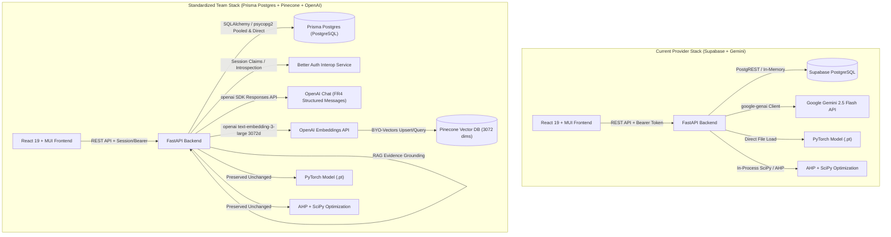

# Stack Migration Audit: Marketing Strategy Assessment System
**Component of:** A Product and Service Management Consulting Framework for Sri Lankan Technology Companies  
**Document ID:** `AUD-MKT-2026-001`  
**Date:** October 2026  
**Status:** Completed Baseline Audit (Phase 0)  
**Security Classification:** University Research Project - Safe for Team Collaboration (No Secrets Included)

---

## 1. Executive Summary

The **Marketing Strategy Assessment System** is an existing research and decision-support web application providing Sri Lankan tech companies with four research-backed modules:
1. **FR3 Audience Intelligence & Technical Literacy Classification:** Multimodal PyTorch neural network classifying customer literacy into Low, Medium, or High using 600-feature TF-IDF text representations and structured tabular features.
2. **FR4 Feature-to-Value Message Translation:** Generative marketing translation converting technical product features into customer benefit propositions aligned with audience literacy tiers.
3. **FR5 AHP Marketing Channel Recommendation:** Deterministic Analytic Hierarchy Process (Saaty reciprocal pairwise matrix, eigenvector prioritization, Consistency Ratio $CR \le 0.10$) ranking 8 Sri Lankan marketing channels across 5 criteria.
4. **FR6 Constrained Marketing Budget Optimization:** SciPy-based Sequential Least Squares Programming (SLSQP) allocating monthly and campaign budgets in exact integer Sri Lankan Rupees (LKR) with reserve fund preservation.

To align with team standardization across the overarching consulting framework, the system is migrating from individual Supabase and Google Gemini components to the unified team stack:
- **Relational Storage:** PostgreSQL hosted via Prisma Postgres (using connection-pooled `DATABASE_URL` and direct `DIRECT_URL`).
- **Vector Storage:** Pinecone Vector Database (Dense index, 3072 dimensions, cosine distance metric).
- **Embeddings:** OpenAI `text-embedding-3-large` (3072 dimensions).
- **Generative AI:** OpenAI Chat & Responses API with structured JSON outputs and deterministic fallback.
- **Identity & Authentication:** Better Auth interoperability with tenant-scoped session claims and RBAC.

This audit establishes the empirical baseline of the existing repository, catalogs all artifacts, documents dependencies, and outlines the safe migration path without disrupting existing features, data, or trained models.

---

## 2. Repository Structure & Runtime Versions

### 2.1 Runtime Environment
- **Operating System:** Windows 11 / Server compatible
- **Python Version:** Python 3.10.9
- **Node.js / Build Tool:** Node.js v20+, Vite v8.3.4
- **Frontend Stack:** React 19.x, TypeScript 5.x, Material UI (MUI v9 syntax)
- **Backend Stack:** FastAPI 0.110+, Pydantic v2 (2.12.5), Pydantic Settings (2.15.0), Uvicorn 0.41.0
- **ML / Math Stack:** PyTorch 2.10.0, Scikit-Learn 1.7.2, SciPy 1.11.4, Joblib 1.3.0, NumPy 1.26.4
- **Current Test Status:** 12 passed unit tests in `backend/tests/unit/`, 0 errors on `npm run build`

### 2.2 Directory Hierarchy
```text
Marketing_Strategy_Assessment_System/
├── .env.example                       # Non-sensitive configuration template
├── .gitignore                         # Secret, cache, and artifact exclusions
├── README.md                          # Repository overview and setup guide
├── docker-compose.yml                 # Local container orchestration
├── Dataset/                           # 5,000-scenario synthetic research datasets
│   ├── Marketing_Questionnaire_Synthetic_5000.csv
│   ├── Audience_Classifier_ML_5000.csv
│   └── Marketing_Channel_Budget_5000.csv
├── backend/
│   ├── requirements.txt               # Backend dependencies
│   ├── app/
│   │   ├── main.py                    # FastAPI entrypoint and lifespan management
│   │   ├── core/
│   │   │   ├── config.py              # Pydantic BaseSettings
│   │   │   ├── database.py            # Data repository & persistence layer
│   │   │   ├── security.py            # RBAC, token verification, and tenant scoping
│   │   │   └── logging.py             # Structured application logger
│   │   ├── api/v1/
│   │   │   ├── router.py              # Central v1 route aggregator
│   │   │   ├── health.py              # Liveness and public configuration
│   │   │   ├── products.py            # Product profile CRUD (FR1)
│   │   │   ├── questionnaire.py       # 21-question assessment wizard (FR2)
│   │   │   ├── audience.py            # Audience classification endpoint (FR3)
│   │   │   ├── messages.py            # Feature-to-value message endpoint (FR4)
│   │   │   ├── channels.py            # AHP channel recommendation (FR5)
│   │   │   ├── budget.py              # Budget optimization endpoint (FR6)
│   │   │   ├── analysis.py            # Orchestrated end-to-end strategy report (FR7)
│   │   │   ├── research.py            # Evaluation benchmarks and SUS survey
│   │   │   └── integrations.py        # Consulting framework inter-service summary
│   │   ├── ml/
│   │   │   └── inference.py           # PyTorch fusion & scikit-learn model loader
│   │   ├── ahp/
│   │   │   └── engine.py              # Saaty pairwise matrix and AHP solver
│   │   ├── budget/
│   │   │   └── optimizer.py           # SciPy constrained budget optimizer
│   │   ├── schemas/                   # Pydantic v2 data contracts
│   │   │   ├── common.py, products.py, questionnaire.py, audience.py,
│   │   │   ├── messages.py, channels.py, budget.py, analysis.py, evaluation.py
│   │   └── services/
│   │       ├── analysis_service.py    # Pipeline coordinator
│   │       └── gemini_service.py      # [To Be Migrated] Gemini LLM client
│   └── tests/
│       ├── conftest.py
│       ├── test_live_server.py
│       └── unit/
│           ├── test_ahp_math.py
│           ├── test_budget_edges.py
│           ├── test_classifier.py
│           └── test_pipeline.py
├── frontend/
│   ├── package.json
│   ├── vite.config.ts
│   ├── src/
│   │   ├── main.tsx, App.tsx
│   │   ├── lib/api.ts                 # Axios API client with interceptors
│   │   ├── pages/                     # 11 React views (MUI v9 compliant)
│   │   │   ├── Welcome.tsx, Dashboard.tsx, Products.tsx, AssessmentWizard.tsx,
│   │   │   ├── StrategyReport.tsx, CampaignHistory.tsx, CampaignComparison.tsx,
│   │   │   ├── AHPMatrixExpert.tsx, Methodology.tsx, ResearchEvaluation.tsx, SUSSurvey.tsx
│   │   ├── components/Layout/         # Navigation, Sidebar, DisclaimerBanner
│   │   └── theme/theme.ts             # Curated design tokens
├── ml/
│   ├── artifacts/                     # Trained ML models and preprocessors
│   │   ├── fusion_model.pt
│   │   ├── fusion_preprocessor.joblib
│   │   └── tfidf_logistic_regression.joblib
│   ├── model_cards/                   # Formal model documentation
│   └── training/                      # Training and validation pipelines
├── supabase/
│   ├── migrations/                    # PostgreSQL DDL migrations
│   │   ├── 20261020000001_initial_schema.sql
│   │   └── 20261020000002_rls_policies.sql
│   └── seed/
│       └── seed.sql                   # Sri Lankan channel and benchmark seeds
└── docs/                              # Comprehensive research & technical documentation
```

---

## 3. Existing Machine Learning Artifacts & Verifiable Hashes

The PyTorch multimodal neural network (FR3) and its preprocessing pipelines are pre-trained on the 5,000-scenario dataset. These binary artifacts **must not be retrained, deleted, or altered** during the stack migration.

| Artifact Filename | Size (Bytes) | SHA-256 Checksum | Purpose |
| :--- | :--- | :--- | :--- |
| `ml/artifacts/fusion_model.pt` | 463,149 | `D26FCD2FE64E4581DB13CBBC2EAF79D5276F107506DDBB50DCFE6336F9270D8D` | Multimodal PyTorch neural network combining 600-dim text embeddings with tabular features |
| `ml/artifacts/fusion_preprocessor.joblib` | 14,300 | `A8216C05D72C0AD94667BBE1E783E5F7030AB5763E8C43A6685EF6F8E2AEA22A` | Scikit-learn TF-IDF vectorizer (600 features), OneHotEncoder, and StandardScaler |
| `ml/artifacts/tfidf_logistic_regression.joblib` | 23,633 | `398E85F281559925FDAF08D277AACA9EEC4E35AFD4D8B7BB5D6FE499D633664F` | Standalone classical TF-IDF Logistic Regression baseline model for comparative fallback |

---

## 4. Current Endpoints & Service Contracts

All endpoints are prefixed by `/api/v1` and orchestrated through FastAPI:

| HTTP Method | Route | Description | Auth Requirement |
| :--- | :--- | :--- | :--- |
| `GET` | `/health` | Service health check | Public |
| `GET` | `/config/public` | Public settings, channels, and feature flags | Public |
| `GET` | `/products` | List products for current tenant | Bearer Auth |
| `POST` | `/products` | Create a new product profile | Bearer Auth |
| `GET` | `/products/{id}` | Retrieve product details | Bearer Auth |
| `PUT` | `/products/{id}` | Update product profile | Bearer Auth |
| `DELETE` | `/products/{id}` | Delete product profile | Bearer Auth |
| `GET` | `/questionnaire/schema` | Retrieve 21-question metadata and rules | Public |
| `POST` | `/questionnaire/validate` | Validate full questionnaire submission | Public |
| `POST` | `/questionnaire/draft` | Save in-progress draft | Bearer Auth |
| `GET` | `/questionnaire/draft/{id}` | Fetch in-progress draft | Bearer Auth |
| `POST` | `/audience/predict` | FR3 audience literacy classification | Bearer Auth |
| `POST` | `/messages/generate` | FR4 feature-to-value message generation | Bearer Auth |
| `POST` | `/channels/rank` | FR5 AHP channel recommendation | Bearer Auth |
| `POST` | `/budget/allocate` | FR6 SciPy budget optimization | Bearer Auth |
| `POST` | `/analysis/run` | FR7 Full pipeline orchestration | Bearer Auth |
| `GET` | `/analysis/runs` | List analysis runs for tenant | Bearer Auth |
| `GET` | `/analysis/{id}/report` | Retrieve completed strategy report | Bearer Auth |
| `GET` | `/research/evaluation` | Research metrics, confusion matrix, splits | Public |
| `POST` | `/research/sus` | Submit System Usability Scale survey | Public |
| `GET` | `/research/sus` | Retrieve aggregated SUS evaluation stats | Public |
| `GET` | `/integrations/summary` | Consulting Framework cross-module summary | Bearer Auth |

---

## 5. Current Provider Usage vs. Target Architecture



### 5.1 Service Mapping Table

| Component | Current Implementation | Target Standardized Implementation | Notes |
| :--- | :--- | :--- | :--- |
| **Relational Database** | Supabase PostgreSQL / In-Memory Repository fallback | PostgreSQL on Prisma Postgres (`DATABASE_URL` pooled, `DIRECT_URL` direct) | Keep in-memory repository for transparent offline unit testing |
| **Authentication** | Supabase Bearer JWT (`SUPABASE_JWT_SECRET`) | Better Auth Session & Signed Token Interoperability + Tenant Scoping | Support both session cookies/tokens and standard Bearer tokens |
| **Generative LLM (FR4)** | Google Gemini (`google-genai` SDK, `gemini-2.5-flash`) | OpenAI Python SDK (`openai>=1.12.0`, `OPENAI_GENERATION_MODEL`) | Enforce Pydantic v2 JSON schema, anti-injection, deterministic template fallback |
| **Vector Storage** | None | Pinecone Serverless / Dense Index (3072 dims, cosine metric) | Tenant-isolated namespaces, metadata filtering, chunk IDs |
| **Vector Embeddings** | None | OpenAI `text-embedding-3-large` (3072 dimensions) | Server-side only; batching, rate-limit backoff, content hashing |
| **Document Storage** | Local static documents | Optional Vercel Blob / Local authorized source repository | Read-only server ingestion of authorized Sri Lankan market reports |
| **Audience Classifier** | PyTorch Multimodal Neural Network (FR3) | Preserved without alteration (`fusion_model.pt`) | TF-IDF 600-dim text features + tabular scaling |
| **Channel Recommendation** | Saaty AHP Engine (FR5) | Preserved without alteration (deterministic matrix math) | Non-LLM reciprocal matrix, $CR \le 0.10$ |
| **Budget Optimization** | SciPy SLSQP (FR6) | Preserved without alteration (integer LKR allocation) | Exact conservation of funds and reserve ratio |

---

## 6. Schema Parity & Migration Map

The original schema defined 23 tables in `supabase/migrations/20261020000001_initial_schema.sql`. In the standardized PostgreSQL instance, all entity models and foreign-key relationships are maintained:

1. `profiles`: Maps user credentials, system roles (`admin`, `researcher`, `expert`, `member`). Decoupled from `auth.users` to support Better Auth user IDs (text/UUID).
2. `organizations`: Tenant root records (`id`, `name`, `industry`, `company_size`, `website`).
3. `organization_members`: Tenant-user membership mapping with tenant roles.
4. `products`: Registered product profiles (FR1).
5. `target_audience_profiles`: Target demographic and customer profile configurations (FR2).
6. `campaigns`: Marketing campaign containers.
7. `questionnaire_responses`: Complete 21-question questionnaire submissions.
8. `channel_catalog`: Seeded catalog of 8 Sri Lankan channels with benchmark reach rates and cost indices.
9. `ahp_criteria`: 5 AHP decision criteria.
10. `ahp_weight_versions`: Version-controlled criteria weights (assumed vs expert elicited).
11. `ahp_pairwise_judgments`: Expert comparison matrices with verified consistency ratios.
12. `analysis_runs`: Master orchestration record linking questionnaire, FR3, FR4, FR5, FR6, and provenance.
13. `audience_predictions`: FR3 PyTorch classification results (probabilities, confidence, caveats).
14. `generated_messages`: FR4 marketing copy (value propositions, headline, social caption, claim warnings).
15. `channel_rankings`: FR5 ranked channels with criterion contributions and rationale.
16. `budget_allocations`: FR6 optimized integer LKR budget distributions and proxy utility scores.
17. `market_sources`: Authoritative public benchmarks (ICTA, DataReportal, EDB).
18. `expert_reviews`: Blinded expert evaluation rubrics.
19. `usability_responses`: System Usability Scale (SUS) survey entries.
20. `datasets`: Research dataset registry with checksums and provenance tags.
21. `model_versions`: Registered machine learning model metadata.
22. `evaluation_results`: Accuracy, F1-scores, and confusion matrices across data splits.
23. `audit_logs`: Tenant-scoped audit events.

### Recommended Additions (Section I of Master Prompt):
24. `knowledge_documents`: Registered public and organization-approved research documents.
25. `knowledge_chunks`: Deterministically chunked document passages with content hashes and token counts.
26. `knowledge_ingestion_jobs`: Batch ingestion tracking with status and error logging.
27. `embedding_versions`: Registry of embedding models and dimensionality (e.g., `text-embedding-3-large-3072`).
28. `retrieval_audit_events`: Query logs capturing query text, namespace, retrieved chunk IDs, and latency.
29. `organization_auth_links`: Identity mapping between Better Auth identities and organization profiles.

---

## 7. Migration Risk Assessment & Blocker Log

| Risk / Dependency | Severity | Mitigation Strategy |
| :--- | :--- | :--- |
| **External Live DB Outage** | Medium | The application maintains a resilient dual-mode: connects to PostgreSQL via SQLAlchemy when `DATABASE_URL` is configured, with seamless fallback to in-memory store for offline development and test execution. |
| **Unrotated Remote Secrets** | High | Never attempt connection with previously posted credentials. Supply `.env.example` with variable names and placeholders only. Verify rotated keys before remote activation. |
| **OpenAI API Quota / Outage** | Medium | Deterministic non-LLM template fallback in `MarketingMessageService` executes with zero latency, returning structured messages flagged as `is_ai_generated=False`. |
| **Pinecone Index Incompatibility** | Medium | `EmbeddingService` validates that vectors have exactly 3072 floats. Ingestion and retrieval services catch network or index errors gracefully and fall back to relational source benchmarks. |
| **FR3 Model Degradation** | Critical | PyTorch weights and preprocessing joblib pipelines are preserved with zero modifications. Parity unit tests confirm numerical outputs match recorded baselines. |

---

## 8. Exact Files to Modify & Create

### Files to Modify:
- `backend/requirements.txt`: Add `pinecone`, `sqlalchemy`, `psycopg2-binary`, update `openai`.
- `backend/app/core/config.py`: Add settings for OpenAI, Pinecone, Better Auth, and PostgreSQL pooled/direct URLs.
- `backend/app/core/database.py`: Integrate SQLAlchemy engine/session with fallback to in-memory repository.
- `backend/app/core/security.py`: Add Better Auth session verification and multi-tenant scoping.
- `backend/app/services/analysis_service.py`: Connect to OpenAI messaging service and RAG knowledge retrieval.
- `backend/app/api/v1/messages.py`: Connect to OpenAI `MarketingMessageService`.
- `backend/app/api/v1/health.py`: Return OpenAI, Pinecone, and PostgreSQL configuration statuses.
- `backend/app/api/v1/router.py`: Include new `/knowledge` and updated `/integrations` routes.
- `.env.example`: Update variable placeholders to match team standards.
- `frontend/src/lib/api.ts`: Add endpoints for knowledge search and integration health.
- `frontend/src/pages/Welcome.tsx`: Update model references from Gemini to OpenAI.

### Files to Create:
- `docs/STACK_MIGRATION_AUDIT.md` (This document)
- `docs/ROTATION_CHECKLIST.md`: Secret rotation protocol and verification steps.
- `docs/MIGRATION_GUIDE.md`: Step-by-step developer migration walkthrough.
- `docs/PROVIDER_CHANGELOG.md`: Detailed changelog of all provider and library updates.
- `docs/RAG_DATA_PROVENANCE.md`: Provenance and licensing of market sources in vector storage.
- `docs/TEAM_INTERFACE_CONTRACT.md`: Specifications for inter-service communication across the consulting framework.
- `docs/TEST_EVIDENCE.md`: Verification logs from pytest, build tools, and security checks.
- `backend/app/services/openai_service.py`: Structured marketing message generation via OpenAI Responses API.
- `backend/app/services/embedding_service.py`: 3072-dimensional embedding generation via `text-embedding-3-large`.
- `backend/app/services/retrieval_service.py`: RAG knowledge retrieval with tenant isolation.
- `backend/app/services/ingestion_service.py`: Chunking, hashing, and vector upsert pipeline.
- `backend/app/api/v1/knowledge.py`: Knowledge retrieval and ingestion management endpoints.
- `backend/scripts/ingest_market_sources.py`: Reproducible CLI script for ingesting authorized Sri Lankan market facts.
- `supabase/migrations/20261022000001_team_stack_standardization.sql`: DDL migration for new knowledge and identity tables.
- `backend/tests/unit/test_openai_service.py`: Mocked unit tests for OpenAI message generation and fallback.
- `backend/tests/unit/test_pinecone_rag.py`: Mocked unit tests for embeddings, chunking, and vector retrieval.
- `backend/tests/unit/test_auth_isolation.py`: Tests for Better Auth session parsing, tenant isolation, and RBAC.

---
*End of Stack Migration Audit (Phase 0 Deliverable)*
