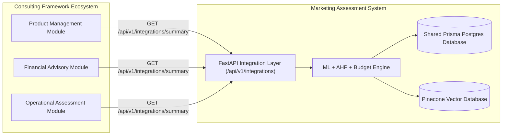

# Team Interface Contract: Consulting Framework Integration
**Component:** Marketing Strategy Assessment System  
**Framework:** A Product and Service Management Consulting Framework for Sri Lankan Technology Companies  
**Document ID:** `INT-CONTR-2026-001`  
**Contract Version:** `v1.0-SL-2026`  
**Status:** Approved Inter-Service Specification  

---

## 1. Overview & Service Boundary

The **Marketing Strategy Assessment System** operates as an autonomous, modular intelligence engine within the larger university consulting framework. Other partner modules (e.g., Product Management, Financial Advisory, Operational Assessment) interact with this service through structured REST APIs and shared PostgreSQL relational storage.



---

## 2. Authentication & Identity Interoperability

### 2.1 Supported Authentication Formats
The system supports two interoperable authentication protocols:
1. **Better Auth Session Cookie:** `better-auth.session_token` transmitted across requests from the shared Next.js / Better Auth portal.
2. **Bearer Token:** `Authorization: Bearer <session_or_jwt_token>` passed in standard HTTP headers.

### 2.2 Caller Claims Contract
Extracted user profile (`AuthUser`):
```json
{
  "user_id": "usr-uuid-or-string",
  "email": "consultant@ceylontech.lk",
  "role": "admin | researcher | expert | member",
  "organization_id": "org-ceylontech-001",
  "is_authenticated": true,
  "auth_provider": "better-auth"
}
```

### 2.3 Cross-Tenant Security Rules
- A caller may only request product evaluations belonging to their own `organization_id`.
- Attempts to query another organization's marketing strategy without `admin` or `researcher` role are rejected with `HTTP 403 Forbidden`.
- Forwarded identity headers (`X-User-Id`, `X-Org-Id`) are never trusted unless backed by a cryptographically verified token.

---

## 3. Inter-Module REST Endpoints

### 3.1 Consulting Framework Marketing Summary
- **Endpoint:** `GET /api/v1/integrations/summary`
- **Authentication:** Required (Bearer Token or Better Auth Session)
- **Parameters:**
  - `product_id` (Query string, required): UUID of target product.
  - `organization_id` (Query string, optional): Target tenant ID.
- **Success Response (`200 OK`):**
  ```json
  {
    "status": "ready",
    "integration_schema_version": "v1.0-SL-2026",
    "organization_id": "org-ceylontech-001",
    "product_id": "prod-001",
    "product_name": "Nivora StockSync Cloud",
    "latest_run_id": "run-e8f192bca012",
    "assessed_at": "2026-10-22T20:30:00Z",
    "target_audience_literacy": "Low",
    "core_value_proposition": "Nivora StockSync Cloud helps retail merchants eliminate stockouts and save 15+ hours weekly on manual paperwork.",
    "recommended_channels": [
      "Facebook",
      "YouTube",
      "Google Ads"
    ],
    "monthly_budget_allocation_lkr": {
      "Facebook": 35000,
      "YouTube": 25000,
      "Google Ads": 15000
    },
    "consulting_framework_contract": "Verified"
  }
  ```

### 3.2 Inter-Service Infrastructure Health Check
- **Endpoint:** `GET /api/v1/integrations/health`
- **Authentication:** Public / Internal Health Monitor
- **Response (`200 OK`):**
  ```json
  {
    "status": "operational",
    "service": "Marketing Strategy Assessment System",
    "database": {
      "status": "connected",
      "provider": "Prisma Postgres (PostgreSQL)",
      "pool_active": true
    },
    "generative_ai": {
      "provider": "OpenAI",
      "model": "gpt-4o-mini",
      "status": "connected"
    },
    "vector_search": {
      "provider": "Pinecone",
      "embedding_model": "text-embedding-3-large",
      "dimensions": 3072,
      "status": "connected",
      "namespace_prefix": "staging-marketing"
    },
    "authentication": {
      "provider": "Better Auth",
      "endpoint": "http://localhost:3000",
      "status": "configured"
    }
  }
  ```

---

## 4. Shared Database Ownership & Table Namespaces

All tables live inside the team's agreed PostgreSQL database. The Marketing Strategy Assessment System owns:

| Entity Name | Prefix / Table Name | Ownership | Access Policy |
| :--- | :--- | :--- | :--- |
| **Products & Profiles** | `products`, `target_audience_profiles` | Marketing Component | Tenant Isolated (`organization_id`) |
| **Assessment & Campaigns**| `campaigns`, `questionnaire_responses` | Marketing Component | Tenant Isolated |
| **Strategy & Optimizations**| `analysis_runs`, `audience_predictions`, `generated_messages`, `channel_rankings`, `budget_allocations` | Marketing Component | Tenant Isolated |
| **Knowledge Base** | `knowledge_documents`, `knowledge_chunks`, `knowledge_ingestion_jobs` | Marketing Component | Public or Scoped by `organization_id` |
| **Catalogs & Reference** | `channel_catalog`, `ahp_criteria`, `ahp_weight_versions`, `market_sources` | Marketing Component | Read-Only to Members |
| **Cross-Module Identity** | `organization_auth_links` | Shared Interop | Read/Write by Service Role |

---
*Maintained by Principal Full-Stack Migration Architect.*
